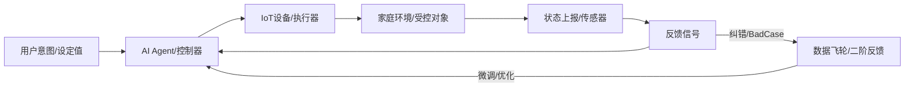

# 🌀 智能家居项目：核心链路全景分析 (基于系统论与控制论)

> **Status**: Verified | **Scope**: System Architecture & Control Engineering | **Update**: 2026-04-14

本文档旨在从**系统论 (Systems Theory)** 的整体性视角和**控制论 (Cybernetics)** 的反馈逻辑出发，深度剖析本项目 (`macinit`) 的核心链路。我们不只是在构建软件，而是在构建一个具备自我调节和进化能力的**“家庭稳态系统”**。

---

## 一、 系统论视角：层级、边界与涌现 (Systems Perspective)

### 1. 系统边界与环境 (Boundaries)
*   **内系统 (Intra-Home System)**: 包含端侧 App、网关及所有 IoT 设备。核心特性是**隐私闭环**与**确定性执行**。
*   **外系统 (Cloud Ecosystem)**: 包含 AI Gateway、Data Flywheel 及第三方服务（OpenAI/AWS）。核心特性是**海量算力注入**与**长尾兜底**。
*   **交互边界**: 通过加密的 MQTT 隧道和 Vector Clock 协议实现端云耦合，确保跨边界状态的一致性。

### 2. 层级架构 (Hierarchy)
1.  **物理执行层 (Actuators)**: 灯光、空调、门锁等物理实体。
2.  **语义理解层 (Controller/Agent)**: 
    *   **端侧 Agent**: 解决高频、隐私、低延迟指令。
    *   **云端 Agent**: 解决复杂、跨域、多模态逻辑。
3.  **进化治理层 (Data Flywheel)**: 负责系统的自我优化与模型迭代。

### 3. 系统涌现性 (Emergence)
*   **主动智能**: 当设备状态、传感器数据与 AI 意图结合时，系统不再是被动响应（开关），而是涌现出“主动预判”的能力（如根据睡眠阶段自动调节环境）。

---

## 二、 控制论视角：反馈、稳定与时延 (Cybernetics Perspective)

### 1. 核心闭环控制模型 (The Control Loop)
本项目遵循标准的闭环控制逻辑：

### 2. 一阶反馈：确定性执行 (Stability)
*   **设定值 (Setpoint)**: 用户下达的自然语言指令（如“调暗客厅灯光”）。
*   **误差信号 (Error Signal)**: 当前设备状态与用户预期状态的偏差。
*   **控制律 (Control Law)**: 
    *   **端侧 GBNF 约束**: 强制 AI 输出符合物模型的 JSON，消除“幻觉”产生的干扰噪声。
    *   **Vector Clock (向量时钟)**: 解决弱网重传导致的系统震荡，确保状态最终收敛到最新指令。

### 3. 二阶反馈：系统进化 (Evolutionary Control)
*   **反馈源**: 用户的手动纠错、执行失败日志。
*   **控制过程**: [Data Flywheel](../../backed_project/README.md#快速启动) 系统将 Bad Case 标记为负样本。
*   **系统收益**: 通过 QLoRA 微调降低稳态误差，提升模型在特定家庭场景下的预测精度。

### 4. 动态特性与时延 (Latency & Dynamics)
*   **传递函数**: 系统的响应速度。
    *   **端侧路径**: 绕过网络 RTT，TTFT ≤ 300ms，实现了“即时反馈”。
    *   **云端路径**: 引入语义缓存 (Semantic Cache)，对高频指令进行前馈补偿 (Feedforward)，减少大模型推理的时延抖动。

---

## 三、 链路核心挑战与控制策略 (Challenges & Strategies)

| 挑战维度 | 系统表现 | 控制策略 |
| :--- | :--- | :--- |
| **时延不确定性** | 云端网络抖动导致反馈滞后。 | **前馈控制 (Feedforward)**: 端侧预加载 Context，拦截高频指令。 |
| **状态竞争 (Race)** | 端云并发修改同一设备状态。 | **并发防御 (Mutex/Clock)**: 基于 Redis Lua 的原子化 Version 校验。 |
| **鲁棒性 (Robustness)** | 断网导致系统“脑死”。 | **离线闭环 (Offline-First)**: 端侧 SLM 作为独立控制器。 |
| **隐私熵 (Privacy Entropy)** | 数据流转过程中的隐私泄露。 | **前置脱敏 (NER Anonymization)**: 在反馈信号离开内系统前进行匿名化处理。 |

---

## 四、 总结：通往自组织系统 (Conclusion)

本项目的核心链路设计已超越了简单的“指令-响应”模式。通过**端云协同的控制器分配**和**数据飞轮驱动的二阶反馈**，我们正在将智能家居打造为一个能感知、能思考、并能不断减少稳态误差的**自组织、自适应系统**。

> *注：未来的优化重点应放在“预测性前馈控制”上，即在用户下达指令前，通过环境传感器趋势提前进行状态调节。*
